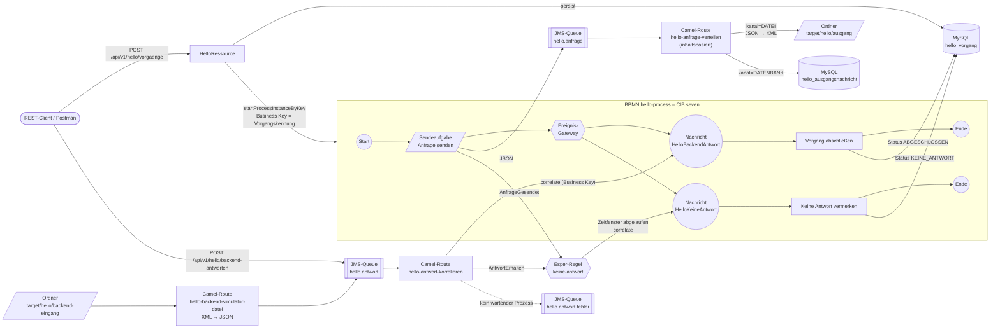

<!--
  Pflege-Backoffice MVP – SPDX-License-Identifier: MIT
  Verantwortlich: <NAME>
  Hauptautor: KI-generiert (Claude Code, Anthropic)
  KI-GENERIERT START (Claude Code, Anthropic)
-->
# Architektur

## Überblick

Das Pflege-Backoffice MVP ist **eine** Quarkus-Anwendung (Modul `app`), die aus mehreren
Maven-Modulen zusammengesetzt wird („modularer Monolith“, Entscheidung E-002):

| Modul | Inhalt | Wer ändert? |
|---|---|---|
| `shared` | Nachrichten-Umschlag, JSON/XML-Formate, RFC-9457-Fehlerformat | Integrationskreis |
| `cep-esper` | Kapselung der Esper-Engine (GPL v2, siehe offene Punkte) | Integrationskreis |
| `hello-process` | Beispielprozess, Vorlage für die Teams | alle (Referenz) |
| `team1-verwaltung` | Team 1: Verwaltung und Erstattung, Vorgangsakte | Team 1 |
| `team2-material` | Team 2: Materialversorgung, Freigaben, Benachrichtigungen | Team 2 |
| `team3-abwesenheit` | Team 3: Geplante Abwesenheit, externe Stellen, Fristen | Team 3 |
| `app` | Startbare Anwendung, `application.properties`, End-to-End-Tests | Integrationskreis |

Laufzeit-Bausteine: CIB seven (BPMN-Engine, eingebettet), Apache Camel (Integration),
ActiveMQ Classic (JMS-Broker, Docker), MySQL (Datenbank für Engine **und** Fachdaten, Docker),
Esper (Ereignisstromverarbeitung, eingebettet), Quarkus REST (JSON, OpenAPI).

Die Teams teilen sich eine Laufzeit. Grenzen zwischen den Teams sind trotzdem klar:
eigenes Modul, eigenes Java-Paket, eigene REST-Pfade `/api/v1/teamX/...`, eigene Queues
`teamX.*`, eigene Tabellen mit Präfix. Kommunikation zwischen Teams läuft über JMS-Nachrichten
oder REST mit dem gemeinsamen Umschlag (siehe `api-konventionen.md`). So kann ein Team später
bei Bedarf in eine eigene Quarkus-Anwendung herausgelöst werden.

## Hello-Prozess: Ablauf

## Zuordnung zu den Pflichtpunkten

| Nr. | Pflichtpunkt | Umsetzung |
|---|---|---|
| 1 | BPMN-Sendeaufgabe → JMS | `hello-process.bpmn` (AnfrageSenden) + `AnfrageSendenDelegate` |
| 2 | Camel: Queue lesen, inhaltsbasiert an ≥ 2 Ziele, JSON ↔ XML | Route `hello-anfrage-verteilen` in `HelloRouten` |
| 3 | Backend simulieren (Datei oder REST) → JMS | Route `hello-backend-simulator-datei` und `POST /api/v1/hello/backend-antworten` |
| 4 | Korrelation an Nachrichten-Zwischenereignis per Business Key | Route `hello-antwort-korrelieren` + `HelloKorrelation` |
| 5 | REST: Prozess starten, Status abfragen | `HelloRessource` |
| 6 | Persistenz in MySQL (Hibernate ORM mit Panache) | `HelloVorgang`, `HelloAusgangsnachricht` |
| 7 | Esper: keine Antwort im Zeitfenster → zurück in den Prozess | `KeineAntwortErkennung` (EPL) + `EsperDienst` |

## Datenbank

Eine MySQL-Datenbank `pflege_backoffice` (Entscheidung E-004):

- `ACT_*` – Tabellen der BPMN-Engine (legt CIB seven beim Start an)
- `hello_*` – Fachtabellen des Hello-Prozesses (legt Hibernate an)
- Vorschlag für die Teams: Tabellen-Präfixe `t1_`, `t2_`, `t3_`

## Technische Hinweise

- **BPMN-Ausdrücke unter Quarkus:** nur Bean-Namen (`camunda:delegateExpression="${meinDelegate}"`),
  keine Methodenaufrufe (`${bean.methode(x)}` → `UnsupportedOperationException`).
- **MySQL-Isolationsstufe:** die Engine verlangt `READ_COMMITTED` (in `application.properties` gesetzt).
- **Prozessmodelle deployen:** je Team eine Klasse wie `HelloProzessDeployment`
  (beobachtet `CamundaEngineStartupEvent`).
- **Weboberfläche (Cockpit, Tasklist, Admin):** optionaler Container `cibseven-ui`
  (`docker compose --profile ui up -d`, <http://localhost:8090>), liest dieselbe Datenbank und führt
  selbst keine Jobs aus (Entscheidung E-007).
- **Fehlerbehandlung JMS:** Antworten ohne wartenden Prozess landen in `hello.antwort.fehler`.
<!-- KI-GENERIERT ENDE (Claude Code, Anthropic) -->
